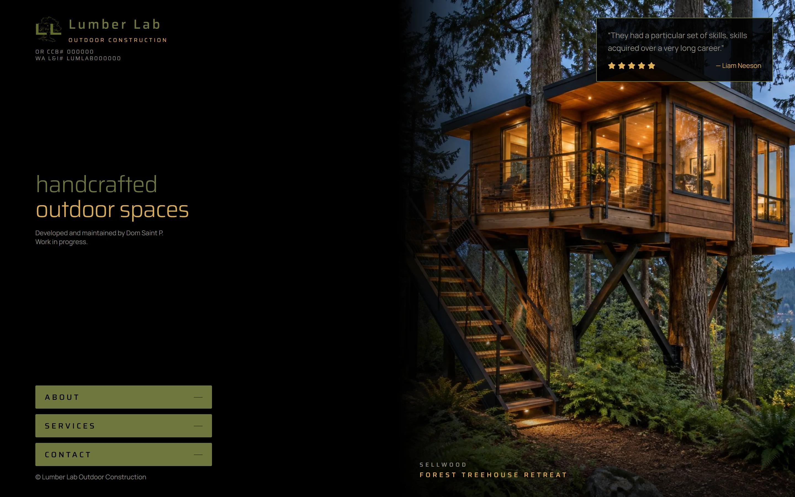

# Lumber Lab

[](https://github.com/lumberlabpdx/outdoorliving/actions/workflows/deploy.yml)

The website for **Lumber Lab Outdoor Construction**, a Portland design & build studio for decks,
patios, pergolas and other outdoor living spaces.

**Live site:** https://lumberlabpdx.github.io/outdoorliving/

[](https://lumberlabpdx.github.io/outdoorliving/)

This is the second version of the site: a new color scheme and look, built on the same design
principles. It's a work in progress, and the reviews and project details on the page are
placeholders for now.

## Design principles

**One screen, not a scrolling brochure.** Most contractor sites stack section after section of
text. This one is a single screen: the brand, a rotating carousel of finished projects, and three
buttons. People find the business through search, reviews, ads, social media and yard signs. By the
time they land here, the site has one job: turn the visit into a phone call.

**Every path ends at a phone.** About, Services and Contact each open a drawer over the page, and
every drawer leads to the same place: call, text, or request a callback.

**One shade per color.** Black background, one gold, one olive, and one grey for all text. Opacity
can vary; shades can't. The whole palette is a handful of tokens at the top of
[`src/styles.css`](src/styles.css), written in OKLCH.

**Two typefaces.** Saira for display type, Manrope for everything else.

**Slow motion.** Photos crossfade every 5.5 seconds under a slow Ken Burns zoom. Nothing bounces.

**SEO lives underneath.** Search engines get metadata and structured data in the page's HTML. None
of it changes what a visitor sees.

**The 404 page breaks every rule above, on purpose.** Try a link that doesn't exist.

## Tech stack

| Layer                   | Tool                                                                                                   | What it does here                                                         |
| ----------------------- | ------------------------------------------------------------------------------------------------------ | ------------------------------------------------------------------------- |
| UI                      | [React 19](https://react.dev)                                                                          | Components; takes over the prerendered HTML in the browser                |
| Framework               | [TanStack Start](https://tanstack.com/start)                                                           | Server rendering and build-time prerendering from one codebase            |
| Routing                 | [TanStack Router](https://tanstack.com/router)                                                         | File-based, fully typed routes in `src/routes/`                           |
| Build                   | [Vite 8](https://vite.dev)                                                                             | Dev server and production bundler (Rolldown)                              |
| Styling                 | [Tailwind CSS 4](https://tailwindcss.com)                                                              | Utility classes; design tokens live in CSS, with no config file           |
| CSS processing          | [Lightning CSS](https://lightningcss.dev)                                                              | Transforms and minifies the CSS                                           |
| Language                | [TypeScript 5](https://www.typescriptlang.org)                                                         | With the strictest compiler settings (see below)                          |
| Validation              | [Zod](https://zod.dev)                                                                                 | The contact form's rules and its TypeScript types, from one schema        |
| Database                | [Supabase](https://supabase.com) (Postgres)                                                            | Stores callback requests, with no server of our own                       |
| Icons                   | [Lucide](https://lucide.dev)                                                                           | Only the icons the page uses end up in the bundle                         |
| Fonts                   | [Saira](https://fonts.google.com/specimen/Saira), [Manrope](https://fonts.google.com/specimen/Manrope) | Served by Google Fonts                                                    |
| Search data             | [schema.org](https://schema.org) JSON-LD                                                               | The business, its service area and its services, for search engines       |
| Hosting                 | [GitHub Pages](https://pages.github.com), [GitHub Actions](https://github.com/features/actions)        | Tested, built and deployed on every push                                  |
| Server build (optional) | [Nitro 3](https://nitro.build)                                                                         | The same code as a server app: Cloudflare Workers, Node, Vercel, Netlify… |
| Tests                   | [Vitest 4](https://vitest.dev)                                                                         | Routing, form validation, form submission and the HTML formatter          |
| Code quality            | [ESLint 9](https://eslint.org), [Prettier 3](https://prettier.io)                                      | typescript-eslint and React Hooks rules; formatting is checked in CI      |

`package.json` lists just nine dependencies (plus dev tools), and there's no component library.
Every element is hand-written with Tailwind, and buttons share one style
([`src/lib/button-class.ts`](src/lib/button-class.ts)).

## How it's built

### A static site from a full-stack framework

TanStack Start normally renders pages on a server. `npm run build:pages` turns on its prerenderer
instead: at build time it renders every page to plain HTML, and React takes over (hydrates) when
the page loads in the browser. Nothing runs on a server in production; GitHub Pages just serves
files. Built with `npm run build`, the same code becomes a server app through Nitro. One flag in
[`vite.config.ts`](vite.config.ts) decides which.

### Works at any address

GitHub Pages serves the site from `/outdoorliving/`, not from `/`. The deploy workflow asks GitHub
for the real path and passes it in as `BASE_PATH`. Vite's `base` and the router follow it, and every
link and icon goes through `import.meta.env.BASE_URL`. The site's full address (used for link
previews and search data) comes from GitHub the same way, so moving to a custom domain needs no code
change.

### Readable page source

React prerenders a page as one enormous line of HTML.
[`scripts/format-html.ts`](scripts/format-html.ts) reformats it after the build, so View Source
reads like hand-written HTML and the JSON-LD is pretty-printed. The catch: a line break between two
tags becomes a text node, and React's hydration would trip over it. So every line break and indent
goes inside a tag, just before its closing `>`, where the HTML parser ignores whitespace:

```html
<!DOCTYPE html>
<html lang="en"
  ><head
    ><meta charSet="utf-8"
    /><title>Lumber Lab</title
```

React's comment markers are left untouched, and the script is TypeScript that Node runs directly,
with no compile step.

### A contact form with no server

The callback form writes straight from the browser to a Postgres table in Supabase, using the
public "publishable" key. That's safe because the database enforces the rules itself: row-level
security lets anonymous visitors insert a row but never read one back, and `CHECK` constraints
repeat the form's length limits, so a hand-crafted request can't get around them. Zod checks the
form in the browser first, with friendly messages. The Supabase client is loaded with a dynamic
`import()` on the first submit, so it isn't part of the initial page download. The table and its
security rules are in [`supabase/migrations/`](supabase/migrations/).

### Content in one place

The business name, phone and email live in [`src/lib/site.ts`](src/lib/site.ts). The carousel
slides, the services and the service area live in [`src/lib/content.ts`](src/lib/content.ts). The
page and the search-engine data both read from these files, so they can't drift apart.

### Structured data for search engines

The page's `<head>` carries Open Graph tags for link previews and a schema.org JSON-LD graph: the
business as a `GeneralContractor`, its service area as a list of cities, and the Services drawer
as an offer catalog. All of it is generated from `content.ts`, so search engines get the full list
of services even though visitors only see it inside a drawer.

### One drawer, three panels

About, Services and Contact share one drawer that slides over the page. While it's open, the page
behind it is `inert`, so keyboard focus and screen readers stay inside the drawer; while it's
closed, the drawer itself is inert. Escape or a click outside closes it. Each opening starts fresh
(scrolled to the top, with an empty form), and a panel's content stays put while the drawer slides
shut, so it doesn't vanish mid-animation.

### Quality gates on every push

[`deploy.yml`](.github/workflows/deploy.yml) runs lint (ESLint and Prettier), the type check, the
tests and a security audit of the production packages before it builds anything. If any step fails,
nothing is published and the live site stays as it was. The workflow has only the permissions it
needs to publish, doesn't keep its Git token after checkout, and times out instead of hanging.

### Strict TypeScript

On top of `strict`, [`tsconfig.json`](tsconfig.json) turns on `noUncheckedIndexedAccess`,
`exactOptionalPropertyTypes`, `noPropertyAccessFromIndexSignature`, `noImplicitReturns`,
`noImplicitOverride`, `noFallthroughCasesInSwitch`, `noUncheckedSideEffectImports`, and
`noUnusedLocals` / `noUnusedParameters`, so unused code fails the type check, and with it the
deploy.

### Supply-chain hygiene

[`.npmrc`](.npmrc) sets `min-release-age=1`: npm won't install a package version that's less than a
day old, since hijacked releases are often caught and pulled within hours. Framework packages are
pinned to exact versions, the lockfile is committed, and CI installs with `npm ci`.

### The 404 page

[`public/404.html`](public/404.html) is a standalone, hand-written page with no framework and no
build step. GitHub Pages serves it at any mistyped address, so a few lines of script work out where
the site lives from the URL and rewrite its own links. It keeps working under `/outdoorliving/` or
on a custom domain. What's on it, we'll leave for you to find.

## Project structure

```
src/
  routes/
    __root.tsx           HTML shell, fonts, icons, fallback 404 and error screens
    index.tsx            the page: brand, carousel, drawer, search-engine data
  components/
    contact-form.tsx     call/text links and the callback form
  lib/
    site.ts              business name, phone, email, site address
    content.ts           carousel slides, services, service area
    contact-schema.ts    the form's validation rules (Zod)
    contact.ts           sends a callback request
    supabase.ts          the lazy-loaded Supabase client
    database.types.ts    database types generated by the Supabase CLI
    button-class.ts      the shared olive-to-gold button style
    error-*.ts           error handling for the server build
  assets/                project photos and the logo
  test/                  Vitest tests
  styles.css             design tokens (colors, fonts) and animations
  server.ts, start.ts    server-build entry point and middleware
  routeTree.gen.ts       route tree, generated by TanStack Router
scripts/                 the post-build HTML formatter
supabase/migrations/     the contact table and its security rules
public/                  favicon, touch icon, robots.txt, the 404 page
.github/workflows/       the test-and-deploy pipeline
```

## Run it locally

Requires Node.js 22.18+ (the build runs a TypeScript script with Node directly) and npm.

```sh
npm install
npm run dev            # http://localhost:8080
```

The whole site works without a database. The contact form just shows its "please call or text us
instead" message until it has one. To hook it up:

```sh
cp .env.example .env   # then fill in your Supabase project's URL and publishable key
```

Then run [the migration](supabase/migrations/20261020200407_create_contact_submissions.sql) in your
Supabase project's SQL Editor to create the table.

| Script                | What it does                                             |
| --------------------- | -------------------------------------------------------- |
| `npm run dev`         | Start the dev server on port 8080                        |
| `npm run build`       | Production server build (output in `.output/`)           |
| `npm run build:pages` | Static build for GitHub Pages (output in `dist/client/`) |
| `npm run preview`     | Serve the production build locally                       |
| `npm run lint`        | Lint with ESLint (includes Prettier's formatting check)  |
| `npm run typecheck`   | Check types with TypeScript                              |
| `npm run format`      | Format with Prettier                                     |
| `npm test`            | Run the tests once with Vitest                           |
| `npm run test:watch`  | Re-run the tests on every change                         |

## Deployment

### GitHub Pages

Every push to `main` runs the [quality gates](#quality-gates-on-every-push) above, then builds the
static site and publishes it. In the repo's Settings → Pages, Source must be set to "GitHub
Actions".

The contact form needs your Supabase project's URL and publishable key at build time. Add them as
repository variables (Settings → Secrets and variables → Actions → Variables):
`VITE_SUPABASE_URL` and `VITE_SUPABASE_PUBLISHABLE_KEY`. Without them the site still deploys, but
the form can't send.

The link-preview image and search-engine data use the address GitHub Pages reports, so they follow
a custom domain on their own (re-run the workflow after adding one).

### Server hosting

`npm run build` produces a server build with [Nitro](https://nitro.build). By default it targets
Cloudflare Workers (`cloudflare-module`). On hosts Nitro detects automatically (Vercel, Netlify,
etc.) it picks the right target on its own. To choose one explicitly, set `NITRO_PRESET` when
building:

```sh
NITRO_PRESET=node-server npm run build
node .output/server/index.mjs
```

In this build, [`src/server.ts`](src/server.ts) wraps the renderer so that a crash shows a plain
error page instead of a raw JSON error.

---

Developed and maintained by Dom Saint P.
